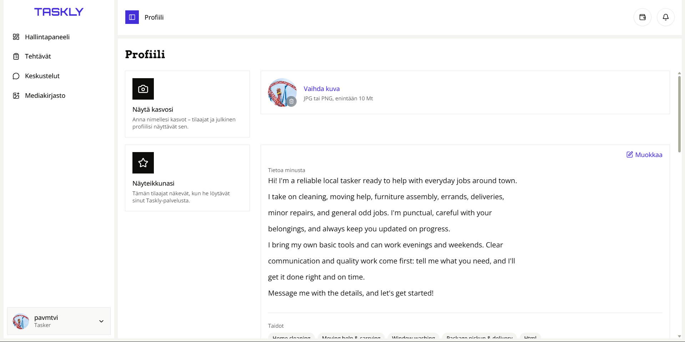
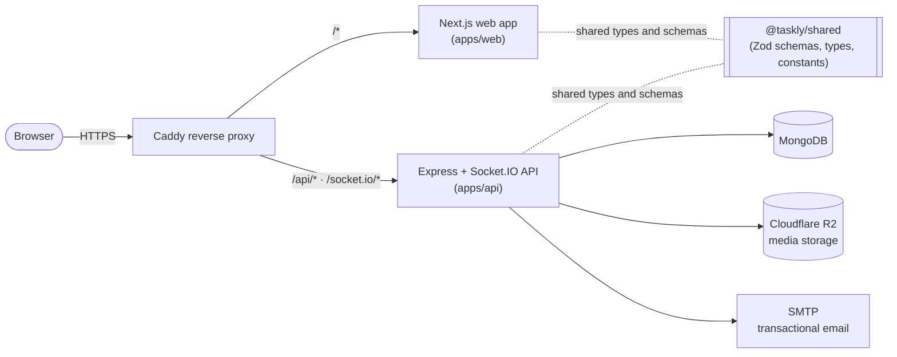
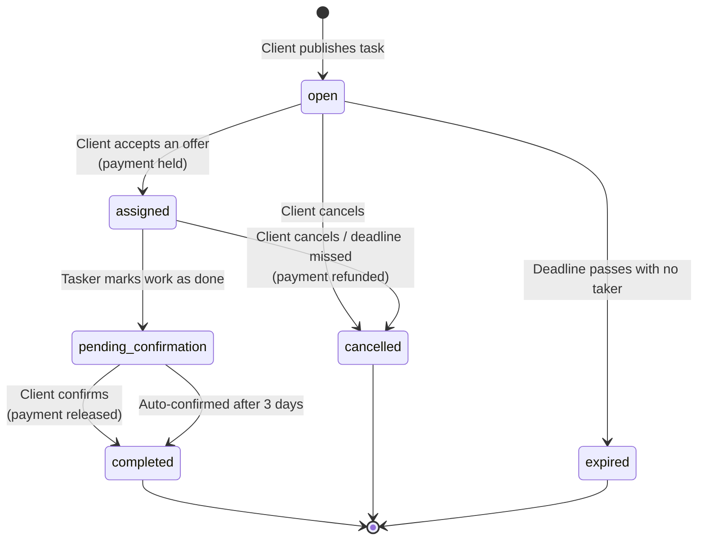

<div align="center">

# Taskly

**A full-stack task marketplace that connects people who need something done with people who can do it.**

Post a task · Receive offers · Chat in real time · Pay safely through escrow · Leave reviews

<br />


</div>

<!--
  Tip: add a hero screenshot or a short GIF here, e.g.
  <p align="center"></p>
-->

---

## Table of Contents

- [Overview](#overview)
- [Key Features](#key-features)
- [Tech Stack](#tech-stack)
- [Architecture](#architecture)
- [Task Lifecycle](#task-lifecycle)
- [Engineering Highlights](#engineering-highlights)
- [Project Structure](#project-structure)
- [Getting Started](#getting-started)
- [Scripts](#scripts)
- [API Overview](#api-overview)
- [Deployment](#deployment)
- [Project Status & Roadmap](#project-status--roadmap)

---

## Overview

Taskly is a two-sided marketplace built as a **TypeScript monorepo**. It is designed around the Finnish market: Finnish banks and IBAN payouts, location-based task search, and a fully localized interface in **English, Finnish and Swedish**.

There are three roles on the platform:

| Role | What they do |
| --- | --- |
| **Client** | Publishes tasks, reviews offers, picks a tasker, confirms the finished work and leaves a review. |
| **Tasker** | Browses tasks nearby, sends offers with a price and a message, completes the work and gets paid. |
| **Admin** | Manages platform content such as the multilingual privacy policy. |

This project demonstrates end-to-end product engineering: data modelling, a secure authentication flow, real-time communication, a media-processing pipeline, background jobs, transactional state changes and a polished, responsive UI.

---

## Key Features

### For clients and taskers

- **Task marketplace**: create tasks with a description, required skills and certificates, budget (fixed or negotiable), location and deadline.
- **Smart search and filters**: filter by status, budget range, skills, certificates and negotiability. Sort by newest, deadline, budget or **distance** using geospatial queries, with a configurable search radius.
- **Offer system**: taskers respond with their own price and message. Clients can accept or decline, and taskers can withdraw.
- **Escrow-style payments**: funds are *held* when an offer is accepted, then *released* or *refunded* depending on the outcome. A payment history with totals is available for both roles.
- **Two-way reviews**: client and tasker rate each other (with a comment) after a task, feeding into public ratings.
- **In-app notifications**: new offers, accepted or rejected offers, completed, cancelled, overdue and expired tasks, and received reviews.

### Communication

- **Real-time chat** over WebSockets with typing indicators, read receipts and file attachments.
- **Online presence** with a privacy option to hide your online status.
- **Rate-limited messaging** to prevent abuse.

### Profiles and trust

- **Public profiles** at a custom handle (`/your-handle`) with a bio, skills, certificates, languages (with CEFR levels A1–C2), a header image and an introduction video.
- **Verification flags** for email, phone and identity.
- **Finnish payout details**: IBAN input with validation and a bank picker for major Finnish banks.
- **Privacy controls**: private profile, hidden online status and notification preferences.

### Platform

- **Internationalization** in English, Finnish and Swedish, with language and theme saved per user.
- **Light and dark themes**.
- **Media library** with per-user storage quota, image and video processing, and signed file delivery.
- **Rich-text editing** with Tiptap and sanitized HTML rendering.
- **Interactive maps** (Leaflet) for picking and displaying locations.
- **Admin-managed, multilingual privacy policy.**

---

## Tech Stack

| Layer | Technologies |
| --- | --- |
| **Frontend** | Next.js 16 (App Router), React 19, TypeScript, Tailwind CSS 4, shadcn/ui and Radix UI, Sass, Tiptap, Leaflet, three.js / React Three Fiber, Swiper, Sonner |
| **Backend** | Node.js, Express 5, TypeScript, Socket.IO, Helmet, CORS, express-rate-limit |
| **Database** | MongoDB (native driver) with transactions, geospatial, text, partial, TTL and collation indexes |
| **Storage** | Cloudflare R2 (S3-compatible) with presigned URLs |
| **Media** | sharp (images), FFmpeg / FFprobe (video, posters), file-type (content sniffing) |
| **Auth and security** | JWT in httpOnly cookies, bcrypt, HMAC-hashed OTP codes, Zod validation |
| **Email** | Nodemailer (SMTP) |
| **i18n** | i18next, react-i18next |
| **Tooling** | pnpm workspaces, tsup, tsx, ESLint, Prettier |
| **Infrastructure** | Railway, Caddy reverse proxy |

---

## Architecture



**Why a monorepo?** The `@taskly/shared` package holds the Zod schemas, TypeScript types and business constants (limits, statuses, allowed file types). The frontend and backend validate against the *same* contracts, so a change to a form or an API shape is caught at compile time on both sides.

---

## Task Lifecycle

Every task moves through a well-defined state machine. State changes that touch money are executed inside **MongoDB transactions**, and a background worker handles time-based transitions.



A scheduler runs every 60 seconds and processes due tasks in batches. It auto-confirms finished work, cancels overdue assigned tasks and expires unclaimed open tasks.

---

## Engineering Highlights

A few implementation details that show the care taken beyond "making it work":

**Security**
- **Revocable sessions**: JWTs carry a `tokenVersion`. Changing it instantly invalidates every active session and disconnects live sockets.
- **Layered rate limiting** with separate limiters for auth (keyed by IP *and* account), OTP, search, uploads, messaging and chat creation.
- **OTP hardening**: HMAC-hashed codes, 10-minute TTL, resend cooldown and a maximum number of attempts.
- **Defensive uploads**: MIME type is verified from file *content* (not just the extension), image pixel counts are capped to prevent decompression bombs, and file names are sanitized for `Content-Disposition`.
- **Secure by default**: Helmet with a CSP, `httpOnly` / `SameSite` cookies, role-based route guards (`requireClient`, `requireTasker`, `requireAdmin`) and safe error responses.

**Data integrity**
- **Transactions** for every state change that affects money or task status.
- **Database-level guarantees**: a partial unique index ensures a task can have only one *held* payment, a unique index ensures one review per author per task, and case-insensitive unique indexes protect usernames and emails.
- **Idempotent, batch-safe background jobs** that guard against overlapping runs.
- **Self-cleaning data**: notifications expire automatically through a TTL index, and unread chat notifications are de-duplicated with a partial unique index.

**Performance and UX**
- **Geospatial search** (`2dsphere`) with distance sorting.
- **Throttled "last seen" updates** to avoid a database write on every request.
- **Request-scoped auth cache** so a request hits the database for the user only once.
- **Cursor-friendly indexes** for chat messages and notification feeds.
- **Presigned, time-bucketed URLs** that stay stable, so browsers can cache media effectively.

**Developer experience**
- A single source of truth for validation and types shared by both apps.
- Consistent service / controller / routes structure in every API module.
- Typed i18n resources with parity across three languages.

---

## Project Structure

```text
taskly/
├── apps/
│   ├── api/                      # Express + Socket.IO backend
│   │   └── src/
│   │       ├── modules/          # Feature modules (routes → controller → service)
│   │       │   ├── auth/         # Register, login, password reset
│   │       │   ├── users/        # Profile, settings, verification, search
│   │       │   ├── task/         # Tasks, offers, lifecycle, scheduled jobs
│   │       │   ├── payment/      # Hold / release / refund, history
│   │       │   ├── chat/         # Conversations and messages
│   │       │   ├── media/        # Uploads, processing, signed delivery
│   │       │   ├── review/       # Ratings and comments
│   │       │   ├── notification/ # In-app notifications
│   │       │   ├── skills/       # Skill catalog
│   │       │   ├── certificates/ # Certificate catalog
│   │       │   ├── otp/          # One-time codes
│   │       │   └── policy/       # Multilingual privacy policy
│   │       ├── utils/            # Limiters, storage, upload, media processing
│   │       ├── app.ts            # Express app and middleware
│   │       └── server.ts         # DB, sockets, auth, indexes, bootstrap
│   └── web/                      # Next.js frontend
│       └── src/
│           ├── app/              # App Router pages
│           ├── screens/          # Page-level views (tasks, chats, auth, profile…)
│           ├── components/       # Shared and UI components
│           ├── providers/        # Socket, chat, task, user, theme, presence…
│           ├── i18n/             # en · fi-FI · sv-FI translations
│           └── lib/              # API client and helpers
├── packages/
│   └── shared/                   # Zod schemas, types and constants used by both apps
├── proxy/                        # Caddy reverse proxy (Dockerfile + Caddyfile)
├── pnpm-workspace.yaml
└── tsconfig.base.json
```

---

## Getting Started

### Prerequisites

- **Node.js** 20 or newer
- **pnpm** 9 (`corepack enable` will set it up)
- A **MongoDB** instance (local or Atlas) with replica-set support, which is required for transactions
- *Optional:* a Cloudflare R2 bucket (media uploads) and an SMTP account (emails)

### 1. Install

```bash
git clone https://github.com/<your-username>/taskly.git
cd taskly
pnpm install
```

### 2. Configure environment

Create a `.env` file in the **repository root** (both apps read it):

```env
# --- General ---
NODE_ENV=development
PORT=3000                          # web
PORT_API=5050                      # api
CLIENT_URL=http://localhost:3000
NEXT_PUBLIC_API_URL=http://localhost:5050
TRUST_PROXY=0

# --- Database & auth ---
MONGODB_URI=mongodb://localhost:27017/?replicaSet=rs0
JWT_SECRET=change-me-to-a-long-random-string
OTP_SECRET=change-me-to-another-long-random-string

# --- Admin account ---
ADMIN_USERNAME=admin
ADMIN_EMAIL=admin@example.com
ADMIN_PASSWORD=change-me

# --- Email (SMTP) ---
SMTP_HOST=smtp.example.com
SMTP_PORT=465
SMTP_SECURE=true
SMTP_USER=user@example.com
SMTP_PASS=change-me

# --- Media storage (Cloudflare R2) ---
R2_ACCOUNT_ID=
R2_ACCESS_KEY_ID=
R2_SECRET_ACCESS_KEY=
R2_BUCKET=

# --- Optional: Telegram relay for outgoing emails / SMS during development ---
BOT_TOKEN=
CHAT_ID=
```

> **Never commit real secrets.** `.env*` files are already listed in `.gitignore`.

### 3. Run

```bash
pnpm dev
```

| Service | URL |
| --- | --- |
| Web app | http://localhost:3000 |
| API | http://localhost:5050 |

---

## Scripts

| Command | Description |
| --- | --- |
| `pnpm dev` | Run web and API together in watch mode |
| `pnpm dev:web` / `pnpm dev:api` | Run a single app |
| `pnpm build` | Build both apps |
| `pnpm start` | Start both apps in production mode |
| `pnpm lint` | Lint web and API |
| `pnpm format` | Format the whole repo with Prettier |

---

## API Overview

All endpoints live under `/api` and use cookie-based authentication.

| Prefix | Purpose |
| --- | --- |
| `/api/auth` | Register, login, logout, current user, password reset |
| `/api/otp` | Send one-time codes |
| `/api/users` | Update profile, change password, verify phone or email, search, public profile lookup |
| `/api/tasks` | CRUD, cancel, complete, mark done, abandon, plus offers (create, accept, decline, withdraw) |
| `/api/payments` | Payment history and totals |
| `/api/chats` | Conversations, messages, read state |
| `/api/media` | Upload, list, delete, signed file and poster delivery |
| `/api/reviews` | Read and create reviews for a task |
| `/api/notifications` | List, mark read, delete |
| `/api/skills`, `/api/certificates` | Searchable catalogs |
| `/api/policy` | Public policy, admin-only update |
| `/api/preferences` | Save theme and language |

**Real-time events** (Socket.IO): `chat:join`, `chat:leave`, `typing:start`, `typing:stop`, `presence:initial`, `presence:online`, `presence:offline`.

---

## Deployment

The project is deployed on **Railway** as three services: `web`, `api` and `proxy`. The Caddy proxy in [`proxy/`](./proxy) is the single public entry point. It routes `/api/*` and `/socket.io/*` to the API and everything else to the web app over Railway's private network.

---

## Project Status & Roadmap

Taskly is an actively developed portfolio project. The core marketplace flow (tasks → offers → chat → payment → review) is working end to end.

**Known limitations**
- Payments are modelled in the database (held / released / refunded) but are **not yet connected to a real payment provider**. The UI uses a mock checkout.
- SMS delivery is a stub. Codes are relayed through the development channel only.
- Automated tests are not included yet.

**Planned**
- [ ] Real payment provider integration
- [ ] SMS provider for phone verification
- [ ] Leaderboard, top-rated taskers and platform statistics pages (UI placeholders exist)
- [ ] Unit and end-to-end test coverage
- [ ] CI pipeline (lint, typecheck, test)

---

<div align="center">

**Built by [Your Name](https://github.com/<your-username>)** · [LinkedIn](https://www.linkedin.com/in/<your-handle>) · [Email](mailto:you@example.com)

*Open to feedback and collaboration.*

</div>
